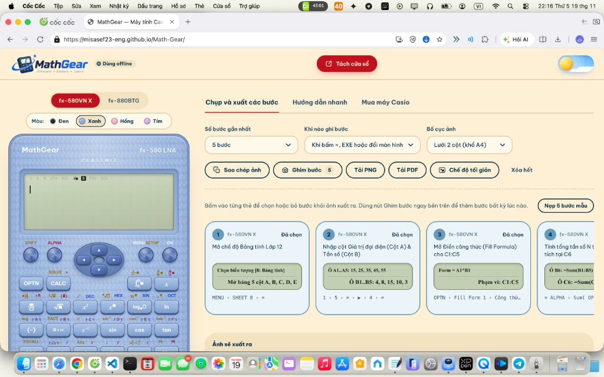
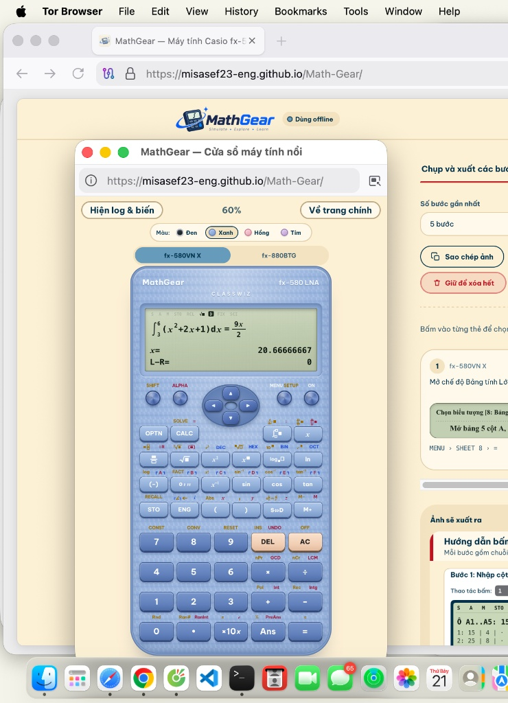

# MathGear — Simulate · Explore · Learn

**MathGear** là ứng dụng web mã nguồn mở (PWA) giả lập 1:1 hai dòng máy tính khoa học phổ biến nhất tại Việt Nam (**fx-580 LNA** và **fx-880BTG**), chạy **100% Offline** không phụ thuộc máy chủ hay kết nối mạng. Dự án được thiết kế dành riêng cho học sinh, sinh viên ôn thi THPT và giáo viên giảng dạy trực tuyến.

## Trải nghiệm trực tuyến & Ảnh Demo

Truy cập trực tiếp bản chạy web tại: [**https://misasef23-eng.github.io/Math-Gear/**](https://misasef23-eng.github.io/Math-Gear/)





## Tính năng nổi bật

* **Giả lập phần cứng 1:1 & 4 phiên bản màu `fx-580`:** Đầy đủ 4 tùy chọn màu vỏ **Xanh Pastel (mặc định)**, **Hồng Pastel**, **Tím Pastel** và **Đen truyền thống**, kèm bộ ký hiệu mặt phím SVG sắc nét và màn hình LCD ma trận điểm tự nhiên (Natural-V.P.A.M.).

* **Cài về máy để dùng khi không có kết nối internet (100% Offline PWA):** Hỗ trợ **Thêm vào màn hình chính (Add to Home Screen)** trên iPhone/iPad, Android, Windows và macOS — tắt Wi-Fi hoặc 4G vẫn sử dụng đầy đủ toàn bộ tính năng.

* **Bộ giải toán Offline & Bảng tính Lớp 12:**

  * **Tính toán thường:** Hiển thị tự nhiên phân số, căn thức, đạo hàm $\frac{\mathrm{d}}{\mathrm{d}x}$, tích phân $\int_a^b$, tổng $\sum$, tích $\prod$, `SHIFT + SOLVE` dò nghiệm chuẩn màn hình máy thật (`x=` / `L−R=`), `CALC`, `FACT`, chia có dư `÷R`, `GCD`/`LCM`, gán biến `STO` (`A–F, x, y, z, M`).

  * **Bảng tính (Spreadsheet Lớp 12):** 5 cột `A–E` × 45 dòng, hỗ trợ công thức `=`, cố định ô `$D$1`, điền công thức hàng loạt (`Fill Formula`), các hàm `Sum`, `Mean`, `Min`, `Max`, `StdDev` cùng mẫu thống kê ghép nhóm.

  * **Các chế độ chuyên sâu:** Phương trình bậc 2–4, hệ phương trình 2–4 ẩn, bất phương trình, bảng giá trị `TABLE`, số phức, thống kê 1 biến, ma trận/vectơ và hệ đếm `Base-N`.

* **Tách cửa sổ nổi tự co giãn & Chế độ tối giản cho giảng dạy online:**

  * **Tách cửa sổ (`Document PiP` / Cửa sổ rời):** Tự động co giãn vừa khít 100% thân máy tính trên mọi kích thước màn hình (kể cả MacBook 11–13 inch), đặt nổi đè lên PowerPoint, đề thi PDF hay Zoom/Google Meet mà vẫn đồng bộ phím bấm trực tiếp với trang chính.

  * **Chế độ tối giản & Chuỗi phím trực quan:** Ẩn toàn bộ bảng phụ để tập trung bấm máy, đi kèm thanh hiển thị chuỗi phím đã bấm và thẻ theo dõi biến (`Ans, x, y, A–C, M`) đặt gọn bên ngoài thân máy.

* **Chụp màn hình & xuất chuỗi nhiều bước (PNG / PDF / Clipboard):** Ghi lại từ 1 đến 10 bước gần nhất gồm cả màn hình LCD lẫn chuỗi phím vật lý, xuất trực tiếp ra ảnh **PNG độ nét 2x**, file **PDF khổ A4 offline** hoặc **Sao chép ảnh** thẳng vào Clipboard.

* **Giao diện Sáng / Tối linh hoạt:** Bảng màu dịu mắt kèm công tắc chuyển đổi bầu trời Ngày – Đêm mượt mà.

## Cấu trúc thư mục

```
Math-Gear/
├── index.html          # Ứng dụng chính (HTML, CSS, Math Engine Offline, cấu hình Affiliate & QR)
├── manifest.json       # Cấu hình cài đặt PWA (Add to Home Screen)
├── sw.js               # Service Worker lưu đệm chạy 100% Offline
├── assets/
│   └── donate-qr.jpg   # Mã VietQR ủng hộ duy trì dự án & hỗ trợ học sinh khó khăn
└── README.md           # Tài liệu giới thiệu & hướng dẫn


```

## Hướng dẫn sử dụng & triển khai

### 1. Chạy trực tiếp trên máy cá nhân

Mở file `index.html` bằng trình duyệt hiện đại (Chrome, Edge, Safari, Cốc Cốc) hoặc khởi chạy máy chủ nội bộ:

```
python3 -m http.server 8080


```

Truy cập `http://localhost:8080` để trải nghiệm đầy đủ tính năng PWA Offline.

### 2. Triển khai miễn phí (GitHub Pages / Vercel / Cloudflare Pages)

* **GitHub Pages:** Đẩy toàn bộ thư mục lên repository `misasef23-eng/Math-Gear`, sau đó vào **Settings → Pages → Branch: `main` (`/root`) → Save**.

* **Vercel / Cloudflare Pages:** Kết nối trực tiếp repository GitHub để tự động phát hành tên miền `https://` chuẩn PWA.

### 3. Cập nhật liên kết Affiliate (Shopee / TikTok Shop)

Mở `index.html`, tìm khối `const AFFILIATE_CONFIG = { ... }` ngay đầu thẻ `<script>` và thay đường dẫn trong `shopeeUrl` hoặc `tiktokUrl` (để chuỗi rỗng `""` nếu muốn ẩn nút mua tương ứng).

## 🔐 Minh bạch và an toàn cùng MathGear

MathGear là dự án mã nguồn mở (Open Source), được phát triển với định hướng minh bạch trong mã nguồn và hoạt động vận hành.

Chúng tôi khuyến khích cộng đồng lập trình viên tham gia kiểm tra, đánh giá mã nguồn, phát hiện và báo cáo các vấn đề bảo mật cũng như đề xuất cải tiến cho dự án tại [github.com/misasef23-eng/Math-Gear](https://github.com/misasef23-eng/Math-Gear).

Mã nguồn công khai cho phép mọi người có chuyên môn chủ động kiểm tra cách thức hoạt động của nền tảng, góp phần nâng cao tính minh bạch và độ tin cậy.

MathGear luôn trân trọng mọi phản hồi từ cộng đồng và hướng đến xây dựng một nền tảng học tập an toàn, hữu ích cho học sinh và giáo viên Việt Nam.

**Minh bạch trong mã nguồn – Cùng cộng đồng xây dựng niềm tin.** 💚

## 💚 Chung tay duy trì MathGear và hỗ trợ học sinh khó khăn

Các khoản đóng góp thông qua mã QR này được sử dụng cho hai mục đích:

* **Duy trì MathGear:** Chi trả các chi phí vận hành dự án như tên miền (domain), máy chủ (hosting) và hạ tầng kỹ thuật cần thiết.

* **Hỗ trợ giáo dục cộng đồng:** Phần kinh phí còn dư sau khi đảm bảo chi phí vận hành sẽ được dành để ủng hộ học sinh có hoàn cảnh khó khăn tại tỉnh Hà Giang (cũ).

**Minh bạch trong mọi khoản đóng góp:**

* Mã QR này liên kết trực tiếp đến một tài khoản ngân hàng được mở riêng, chỉ phục vụ việc tiếp nhận và quản lý kinh phí của dự án MathGear. Tài khoản không được sử dụng cho bất kỳ giao dịch thanh toán hay chi tiêu cá nhân nào.

* Toàn bộ các khoản đóng góp và chi phí sử dụng đều được ghi nhận riêng biệt, có thể đối chiếu thông qua lịch sử giao dịch và sao kê ngân hàng.

* Sau khi đảm bảo các chi phí vận hành, phần kinh phí còn dư sẽ được dành để ủng hộ học sinh có hoàn cảnh khó khăn tại khu vực tỉnh Hà Giang (cũ).

* Các khoản hỗ trợ học sinh sẽ được chuyển 100% thông qua chính quyền địa phương để đảm bảo đúng đối tượng và mục đích hỗ trợ.

Mỗi sự đóng góp, dù lớn hay nhỏ, đều là nguồn động viên quý giá giúp MathGear tiếp tục được duy trì và lan tỏa những giá trị tích cực đến cộng đồng.

Cảm ơn bạn đã đồng hành cùng MathGear! 💚

